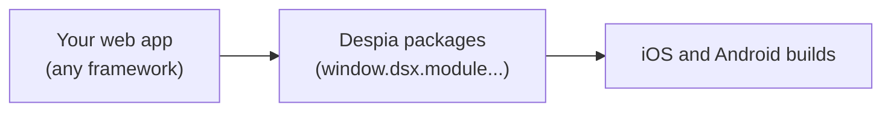

import EnvNew from '/snippets/env-new.mdx';

## What is Despia

Despia turns your web app into an iOS and Android app. Your web app runs unchanged inside a native shell: the app's web view loads your existing site. Native features (purchases, push notifications, biometrics, haptics, health data and more) reach your page through one global object, `window.dsx`. No SDK is installed and no rewrite is needed.

<Note>Despia V4 is currently a **pre-release (0.0.2)**, stable for web view apps. Native UI is coming soon.</Note>

## How it works



1. **Your web app.** Your site and framework stay as they are. Despia loads the site in the app's web view.
2. **Despia packages.** Each native feature is a package. Each package answers on `window.dsx.module.<package>`.
3. **iOS and Android builds.** Despia builds the apps for the App Store and Google Play.

<EnvNew />

## What you can add

This documentation covers 48 packages your web app can call today, in these groups. Packages marked **Alpha** are early implementations; the rest are verified on iOS and Android.

| Group | Packages |
| :-- | :-- |
| Purchases and payments | [RevenueCat](/packages/revenuecat), [Store](/packages/store), [Payments](/packages/payments) |
| Sign-in and identity | [OAuth](/packages/oauth), [Clerk](/packages/clerk), [Biometric](/packages/biometric), [Identity Vault](/packages/identityvault) |
| Notifications | [Notify](/packages/notify), [OneSignal](/packages/onesignal), [Pushwoosh](/packages/pushwoosh), [Firebase](/packages/firebase) |
| Analytics and attribution | [AppsFlyer](/packages/appsflyer), [PostHog](/packages/posthog), [App tracking](/packages/apptracking) |
| Device and system | [Haptics](/packages/haptic), [Device](/packages/device), [Clipboard](/packages/clipboard), [System bars](/packages/systembars) and more |
| Media, files and sharing | [Camera](/packages/camera), [Scanner](/packages/scanner), [Share](/packages/share), [Wallet](/packages/wallet) and more |
| Health | [HealthKit](/packages/healthkit), [Terra](/packages/terra) |
| Connectivity | [NFC](/packages/nfc), [WebSocket](/packages/websocket), [Nearby](/packages/nearby), [Bluetooth](/packages/bluetooth) |
| Speech | [Speech recognition](/packages/speechrecognition), [Speech synthesis](/packages/speechsynthesis) |
| Data and contacts | [Storage](/packages/storage), [Contacts](/packages/contacts) |
| Compliance | [Age assurance](/packages/ageassurance) |

The full list is in the sidebar under **Packages**. Start with [Modern API](/packages/overview) and [How calls, results and broadcasts work](/packages/concepts).

## Quick start

<Tabs>
  <Tab title="Console">
    1. In the Despia console, create a new app with the **Web App to Mobile App** template and your web app's address.
    2. In the app, open **Packages**, click **Add Packages** and add what you need.
    3. Open **Builds** and build for iOS and Android.

    See [Add a package](/packages/add-a-package) for every step.
  </Tab>
  <Tab title="CLI">
    ```bash
    npx despia login
    npx despia new "My App" --template web-view --set url=https://app.your.site --apply
    npx despia add haptic
    npx despia build ios --cloud --plan
    ```

    Requires the published `@despia-native/cli` package, 0.0.2 or later. `new` and `build --cloud` without `--apply` / with `--plan` only check and show what would happen. See [Add a package](/packages/add-a-package).
  </Tab>
</Tabs>


{/* TODO-VERIFY: the console label for starting a build was not read from the console source. Template name and CLI line: OpenSource/Templates/web-view/README.md. */}
{/* TODO-VERIFY: npm latest of @despia-native/cli is the placeholder 0.0.0-coming-soon.0 on 2026-10-10; 0.0.2 must be published before the CLI steps work outside a template project. */}

## Works with every framework

<CardGroup cols={3}>
  <Card title="React (Vite)" icon="react" href="/packages/frameworks/react" />
  <Card title="Next.js" icon="n" href="/packages/frameworks/nextjs" />
  <Card title="TanStack Start and TanStack Router" icon="layer-group" href="/packages/frameworks/tanstack" />
  <Card title="React Router v7 and Remix" icon="route" href="/packages/frameworks/react-router" />
  <Card title="Preact" icon="atom" href="/packages/frameworks/preact" />
  <Card title="Vue 3 (Vite)" icon="vuejs" href="/packages/frameworks/vue" />
  <Card title="Nuxt" icon="mountain" href="/packages/frameworks/nuxt" />
  <Card title="Svelte 5 (Vite)" icon="s" href="/packages/frameworks/svelte" />
  <Card title="SvelteKit" icon="s" href="/packages/frameworks/sveltekit" />
  <Card title="SolidJS and SolidStart" icon="cube" href="/packages/frameworks/solid" />
  <Card title="Angular" icon="angular" href="/packages/frameworks/angular" />
  <Card title="Astro" icon="rocket" href="/packages/frameworks/astro" />
  <Card title="Qwik" icon="bolt" href="/packages/frameworks/qwik" />
  <Card title="Lit and web components" icon="puzzle-piece" href="/packages/frameworks/lit" />
  <Card title="Plain HTML and vanilla JS" icon="html5" href="/packages/frameworks/html" />
</CardGroup>

See [Which approach for my stack](/packages/frameworks/overview).

## Coming from Despia V3

<Info>Apps built on Despia V3 keep working on Despia V4: the Legacy polyfill answers their `despia('scheme://...')` calls. See [Migrate from Despia V3](/packages/migrate-from-v3). The original Despia V3 introduction is in the Legacy tab: [Despia V3 introduction](/despia-v3).</Info>

## FAQ

<AccordionGroup>
  <Accordion title="Do I need to rewrite my app?">
    No. The web app runs as it is. Native features are added where needed, through `window.dsx`.
  </Accordion>
  <Accordion title="Which frameworks work?">
    Any web framework: React, Next.js, Vue, Nuxt, Svelte, SvelteKit, Angular, SolidJS, Astro or plain HTML. See [Frameworks](/packages/frameworks/overview).
  </Accordion>
  <Accordion title="Does Despia run on a server?">
    No. Despia code runs only in the app's web view, in the browser. In frameworks that render on the server, call it from an effect or event handler.
  </Accordion>
  <Accordion title="What is window.dsx?">
    The one global object every Despia V4 app puts on the page. Every package in your app answers on `window.dsx.module.<package>.<action>()`. In a normal browser it is `undefined`. See [Modern API](/packages/overview).
  </Accordion>
  <Accordion title="How do native features work?">
    Each feature is a package. You call its actions and get a result, or listen to its broadcasts. See [How calls, results and broadcasts work](/packages/concepts).
  </Accordion>
  <Accordion title="Can I use AI coding agents?">
    Yes. The API is one global with plain JavaScript calls. Point coding agents at [How calls, results and broadcasts work](/packages/concepts).
  </Accordion>
  <Accordion title="Is my Despia V3 app still working?">
    Yes. The Legacy polyfill keeps Despia V3 calls working on Despia V4. See [Migrate from Despia V3](/packages/migrate-from-v3).
  </Accordion>
  <Accordion title="Where does my data live?">
    In your own services. Despia never hosts your app, your backend or your users' content. The web app stays on your own hosting.
  </Accordion>
</AccordionGroup>
